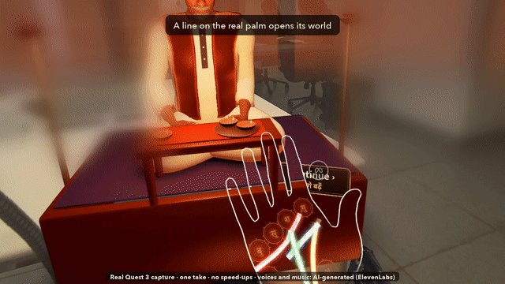
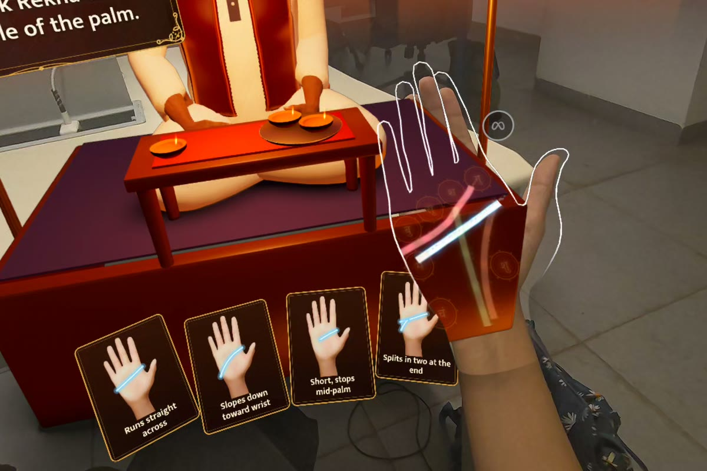
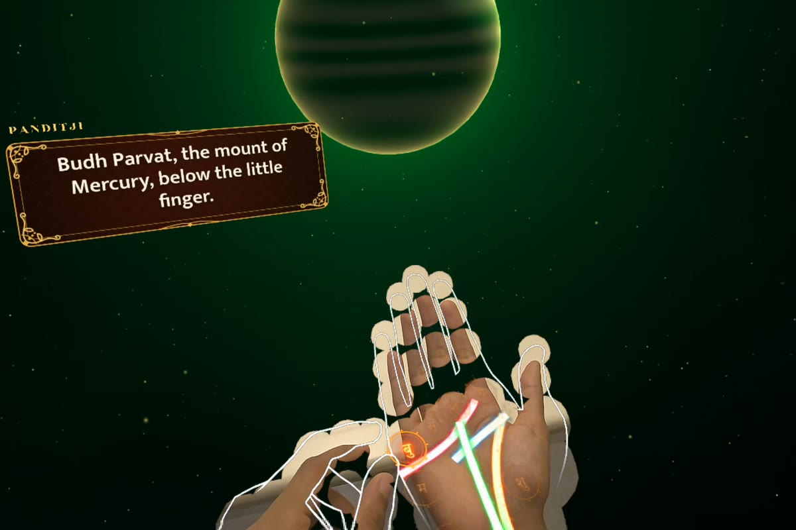
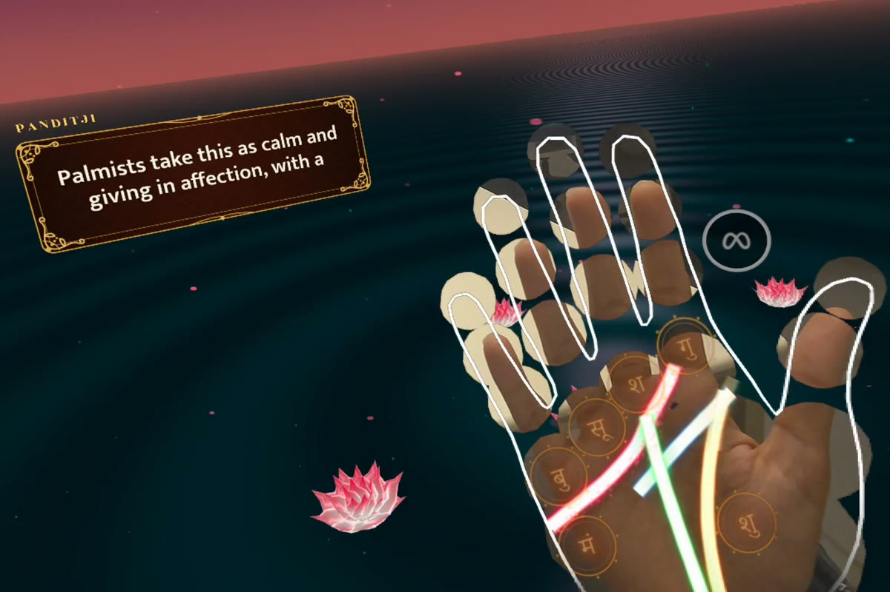
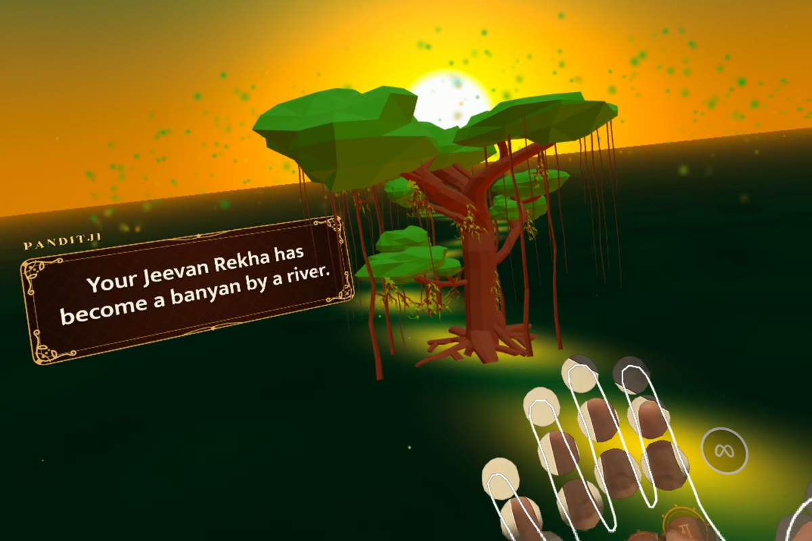
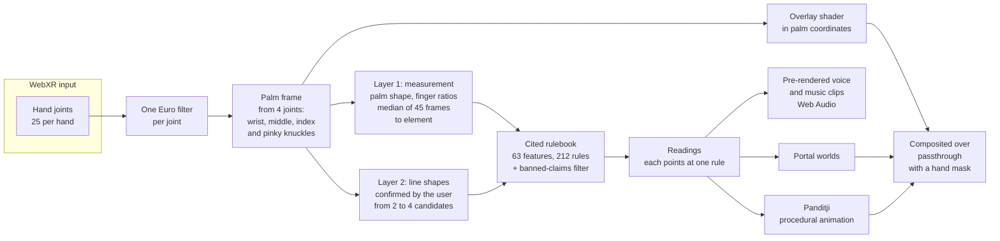
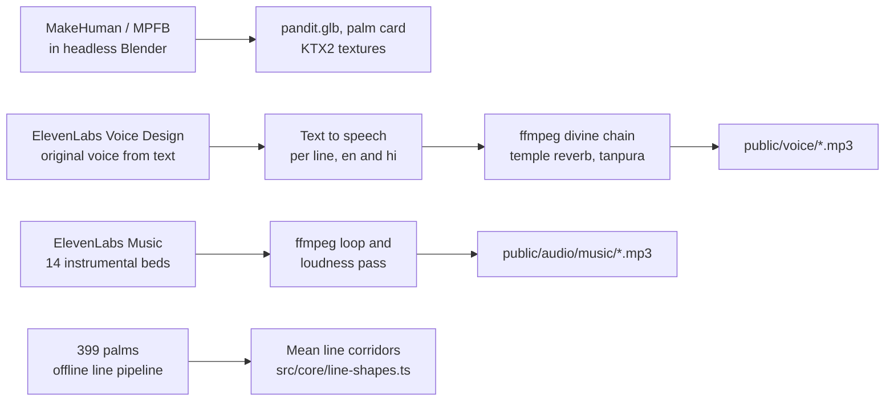

<p align="center">
  
</p>

<h1 align="center">Palmverse</h1>

<p align="center">
  <b>Hast Rekha (हस्त रेखा), the Indian tradition of reading the hand, drawn in light on your real palm in mixed reality.</b><br>
  Touch a line and step into its world. Hands only, on Meta Quest 3.
</p>

<p align="center">
  <a href="LICENSE"></a>
  <a href="https://github.com/saurabh4269/palmverse/actions/workflows/ci.yml"></a>
  
  
  
  
</p>

## Try it

- **Live demo:** https://palmverse-lilac.vercel.app (open it in Meta Quest Browser)
- **Demo video:** https://vimeo.com/1248087914 (2:23, recorded on a real Quest 3)

Open the live URL in Meta Quest Browser on a Quest 3 or 3S, press **Enter**, and hold up your palm. No install, no controllers, no account.

## What it is

Samudrika Shastra is the old Indian study of the marks of the body, and Hast Rekha is its branch that reads the lines and mounts of the hand. In India it is everywhere: an elder at a family function takes your hand, or a reader outside a temple does. Very few people know what the old texts actually say, or which parts of it are old at all. Palmverse teaches it on the one surface it is about: **your real palm is the canvas.**

Panditji, an original scholar character, sits across a low table in your room. The app measures the shape of your hand from hand tracking, draws the four great lines and seven mounts in light on your skin, and lets you step into a world for each line. Every statement about your hand cites a source, and the app is clear throughout that this is culture and story, not a forecast.

## The experience in 5 minutes

All images below are frames from one continuous session on a physical Quest 3 in Quest Browser. Nothing is rendered in an emulator or retouched.

| | |
|---|---|
|  |  |
| **1. Measure, then read your own lines.** The app reads your hand's shape from the tracked joints and names its element. For each line, cards show 2 to 4 candidate shapes; the one you hover glows on your palm so you can compare it with your own creases. | **2. Mounts are planets.** Touch a mount with a fingertip of your other hand and the room opens into that graha's sky, here Budh (Mercury). Panditji tells you what the old books say about it. |
|  |  |
| **3. Every line is a world.** Touch or pinch a glowing line and a portal opens out of your palm. The heart line becomes a lotus pond. Your hands stay real inside the world, with the lines still drawn on them. | **4. Close your fist to come back.** The life line is a banyan by a river; the head line is a sky of stars joining up; the fate line is Shani's ringed planet above a road of light. A fist folds the world back into your palm. |

At the end you get a **Rekha card** with your element and line shapes, saved only on the headset, and you can read your other hand. Everything is voiced and captioned in English, with a full Hindi mode. The step-by-step guide is in [docs/HOW-TO-PLAY.md](docs/HOW-TO-PLAY.md).

**Three gestures, no controllers:** show your palm, touch or pinch a line, close your fist. Buttons are poked with a fingertip.

## Why mixed reality

- **There is no palm to read without passthrough.** On a flat screen, or in VR without passthrough, the overlay has nothing to sit on. Here it is built in palm coordinates from four tracked joints and rebuilt every frame, so it stretches and turns with your hand.
- **Your hands are the controller.** The thing being read is the thing doing the interacting.
- **The worlds keep your hands real.** When a world opens around you, your hands are masked back into passthrough, so you still see your own palm inside it with the lines on top.

## Architecture

The app is a WebXR `immersive-ar` session built with Meta's [IWSDK](https://github.com/facebook/immersive-web-sdk) (three.js, TypeScript). One director system runs an explicit phase machine; everything it decides about your hand comes from pure, unit-tested modules in `src/core/`.



All assets are made offline and committed, so the app makes no API calls at runtime:



The module map, the phase machine and the rendering notes are in [docs/ARCHITECTURE.md](docs/ARCHITECTURE.md). The decisions behind them, mapped to the judging criteria, are in [docs/JUDGING.md](docs/JUDGING.md).

## Safety and honesty by design

- **Cited rules.** 63 hand features and 212 rules from Cheiro (1916), Benham (1900), Varahamihira's *Brihat Samhita* (chapter 68) and modern Indian guides, each with its source. Every sentence Panditji says about your hand points at exactly one rule, and a test checks that every pointer resolves.
- **A banned-claims filter in code.** A reading is dropped if it mentions death, lifespan, illness, fertility, divorce, money loss or anything phrased as a prediction ("you will"). `tests/rules.test.ts` runs 4,000 fuzzed hand profiles and choices through it.
- **Not a forecast.** The first card and the Rekha card both say "A cultural entertainment. Not a forecast. Not advice." Before signing off, Panditji explains the Barnum effect, and he tells you that the heart and head lines and the planetary mounts reached Indian practice through Cheiro and Benham in the 20th century.
- **No faked detection.** The app does not read your creases with a camera. Quest Browser does not give web pages the passthrough camera frames. It measures your hand's shape from the tracked joints, and you confirm your line shapes by comparing candidates with your own palm. Panditji says so during the reading.
- **Nothing leaves the headset.** No camera access, no server, no accounts, no analytics. Fonts, voice and music are bundled. Past readings are kept in this browser's `localStorage` only (see `src/core/save.ts`); the card is a drawing, never a photo.

## Real-device results

Measured on a Meta Quest 3 in Quest Browser 156, over about 8 minutes of logged play:

| Metric | Result |
|---|---|
| Frame rate | median 74 fps |
| Draw calls per frame | median 36 |
| Known issue | short dips when a world first loads (shader and texture upload), still being tuned |

The numbers were collected by a small dev-only debug relay, [`tools/quest-debug.mjs`](tools/quest-debug.mjs). It is a Vite plugin that runs only under the dev server and only on Quest Browser: it forwards console output, errors, frame timing and draw calls from the headset to the laptop over Wi-Fi, with no adb. Nothing of it reaches the production build.

The first headset session also changed the design: the palm overlay now uses hysteresis (picked up at about 55 degrees, kept until about 78) so it does not blink off when you tilt your palm to touch it, and a pinch opens the line that is lit rather than the nearest one. Details are in [docs/TESTING.md](docs/TESTING.md).

## Testing

| Suite | Command | What it covers |
|---|---|---|
| Unit tests | `npm test` | 3,193 checks in 7 suites: palm-frame maths (41), fingertip-to-line touch (77), One Euro filter (3), rule engine with the safety fuzz (2,581), share-card layout (283), spoken lines and voice coverage (191), world narration (17). Runs in Node with esbuild; no browser needed. |
| Typecheck | `npm run typecheck` | `tsc --noEmit` over the whole app |
| Emulator end-to-end | `npm run test:xr` | 56 checks. Drives the whole reading with emulated hands only (no controllers) in the IWSDK emulator: welcome, raise, scan, reveal, mounts, line choices, explore, reading, card, other hand. `--worlds` adds touch-opening the line worlds (65 checks). |

The unit tests and the build run in CI on every push and pull request. The emulator end-to-end test needs a managed browser and the IWSDK dev server, so it runs locally:

```bash
npx @iwsdk/cli dev up --ai-mode agent   # managed HTTPS dev server and emulator browser
npm run test:xr                          # python3 tools/e2e.py; screenshots go to artifacts/
python3 tools/shots.py <prefix>          # close-up stills of the palm overlay for visual review
```

## Getting started

**Prerequisites:** Node 20.19+, 22.12+ or 24+ (`.nvmrc` pins 22.12.0). Python 3 only for the emulator test and the offline asset tools. A Meta Quest 3 or 3S to try it for real.

```bash
git clone https://github.com/saurabh4269/palmverse.git
cd palmverse
npm ci
npm run dev        # HTTPS dev server on port 8087 plus the IWSDK emulator (Meta Quest 3 profile)
npm run build      # static site in dist/
```

**On a Quest:** put the headset on the same Wi-Fi as your computer, open the dev server's network URL (`https://<your-computer's-LAN-IP>:8087`) in Meta Quest Browser, accept the self-signed certificate warning, then press **Enter**. To share it, deploy `dist/` to any static HTTPS host (`vercel.json` is included). WebXR needs HTTPS.

**Controls:** show your palm to start a reading, touch or pinch a glowing line (or mount) to open its world, close your fist to come back. Poke buttons with a fingertip.

**Re-rendering the voice and music (optional).** The clips are already committed, so you do not need this to run the app. To change a line or the sound of the voice, set `ELEVENLABS_API_KEY` in your shell (or pass `--key-file`) and follow [tools/voice/README.md](tools/voice/README.md) and `tools/music/make_music.py`. Never commit the key.

## Project structure

```
src/
  director.ts      the phase machine: welcome, raise, scan, reveal, mounts, lines, explore, reading, card
  core/            pure logic, unit-tested in Node: palm frame, measurement, line shapes, touch, rules, One Euro
  content/         Panditji's script, the reading library, world narration, Hindi
  data/            the cited rulebook and palm regions (JSON)
  render/          overlay shaders, Panditji, pavilion, portal worlds, cards, subtitles, audio, voice playback
  page.ts          the 2D page: framing, Enter button, saved Rekha cards
public/            runtime assets: models (KTX2), voice clips, music, environment light, palm card art
tests/             unit tests (run by tools/run-unit.mjs)
tools/             emulator e2e, Quest debug relay, offline asset pipelines (Blender, voice, music, textures)
assets-src/        uncompressed Blender outputs (not deployed)
docs/              architecture, judging notes, testing log, how to play, media
```

## Roadmap

Working now: hand shape measured from tracking, line shapes you confirm yourself, the mount and line worlds, the Rekha card, English and Hindi.

Planned:
- **A camera crease scan**, if Quest exposes passthrough camera frames to web pages. The offline pipeline already traces heart, head and life lines from photos (on 300 photos, 148 passed its quality check), but it has no human ground truth yet. `public/probe.html` checks whether a browser grants camera access.
- **Review by people who know the tradition.** We are not scholars of Samudrika Shastra. We want scholars and practising palm readers to review the readings and the framing.
- **Native-speaker review of the Hindi**, which was translated with AI.
- **More hands.** The measurement thresholds come from photo datasets, not from Quest joint data, so it needs trying on many more people.

## Credits and licenses

The code is released under the [MIT License](LICENSE). Assets keep their own licences; the full list is in [CREDITS.md](CREDITS.md).

- **Banyan model:** "Vine Covered Tree" by Zacharylll on [Poly Pizza](https://poly.pizza/m/dlW4hGKBpiS), CC-BY 3.0, adapted (see [public/models/CREDITS.md](public/models/CREDITS.md)).
- **Panditji and the palm card hand:** original characters built with MakeHuman / MPFB 2 (CC0 output and CC0 assets); costume generated in code.
- **Fonts:** Mukta, Rozha One and Tiro Devanagari Hindi, SIL Open Font License 1.1, bundled via Fontsource.
- **AI-generated audio:** Panditji's voice and the Aakashvani opening voice are original synthetic voices designed with ElevenLabs Voice Design from text descriptions (no one's voice was cloned). The 14 music loops were generated with ElevenLabs Music. Both were made under a paid ElevenLabs plan.
- **AI-assisted translation:** the Hindi script was translated from English with Claude; a native-speaker review is pending.
- **Palmistry sources:** Cheiro, *Palmistry for All* (1916) and Benham, *The Laws of Scientific Hand Reading* (1900), both public domain in the USA, and Varahamihira, *Brihat Samhita* ch. 68. All readings are paraphrased.
- **Software:** IWSDK (MIT), three.js via `super-three` (MIT), `@pmndrs/uikit` (MIT), Basis Universal transcoder (Apache-2.0), `vercel.json` from `meta-quest/iwsdk-v0-template` (Apache-2.0).
- **Research:** the rulebook, the 399-palm line pipeline and the design notes live in the [meta-vr-start-2026-kit](https://github.com/saurabh4269/meta-vr-start-2026-kit) repository ([rulebook](https://github.com/saurabh4269/meta-vr-start-2026-kit/blob/main/research/palmistry-rulebook.md), [palm-autolabel](https://github.com/saurabh4269/meta-vr-start-2026-kit/tree/main/research/palm-autolabel), [magic design](https://github.com/saurabh4269/meta-vr-start-2026-kit/blob/main/research/hast-rekha-magic-design.md)).

## Built for

The **Meta VR Start Developer Competition 2026**. Developed under the working name Hast Rekha.

Contributions are welcome: see [CONTRIBUTING.md](CONTRIBUTING.md) and the [Code of Conduct](CODE_OF_CONDUCT.md). Security issues: [SECURITY.md](SECURITY.md).
